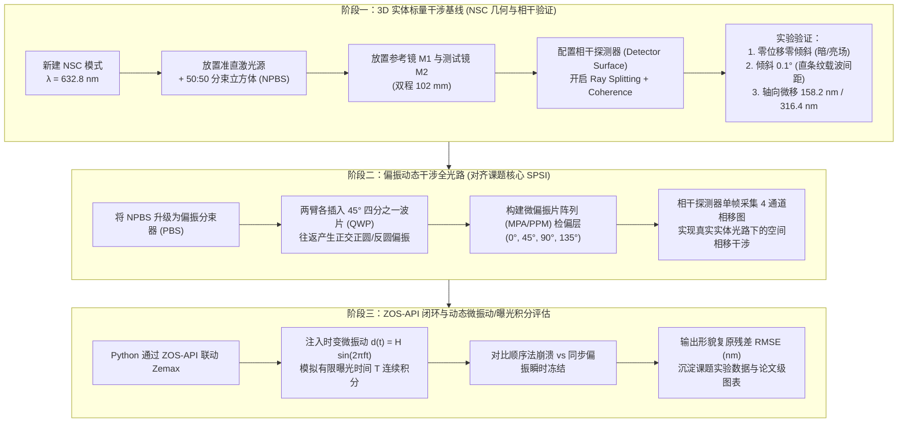

# 2026-10-23 工具升级（OpticStudio Premium）后的动态干涉研究路线重构

## 一、升级背景与核心研究目标对齐

2026-10-23，用户成功部署了 **Ansys Zemax OpticStudio 2024 R1.00 Premium (64-bit)** 旗舰顶配版。
相比之前的 Student 版（仅顺序单臂追迹、无 NSC、无相干探测、无 API），工具环境发生了质的跃迁。

然而，**工具的升级绝不意味着从零推倒重来，更不意味着盲目点软件**。
必须紧密锚定李建欣老师课题组的核心研究主题——**动态干涉测量技术（Dynamic Interferometry）与同步偏振相移（SPSI / PPM）抗微振波前测量**，将前期已完成的理论推导、文献精读、Python 算法基线与升级后的 NSC 3D 实体光路深度咬合。

---

## 二、前期成果与当前科研资产盘点

1. **理论与物理机制（已建立）**：
   - 双光束相干叠加、可见度公式、四步相移反正切解调（Arctan）；
   - Jones 矩阵与正交偏振干涉（PBS + 双 QWP 实现参考光与测试光转化为正交圆偏振光）；
   - 空间微偏振片阵列（MPA/PPM，Millerd 2005 / Novak 2005）的 $2\times 2$ 空间相移机制；
   - 镜面微位移与相位严格映射关系：$\Delta\mathrm{OPD} = 2d \iff \Delta\phi = \frac{4\pi}{\lambda} d$（$\lambda = 632.8\,\mathrm{nm}$，$\lambda/2 = 316.4\,\mathrm{nm}$ 对应一整条条纹）；
   - 镜面倾斜 $\theta = 0.1^\circ \iff$ 返回偏转 $2\theta = 0.2^\circ \iff$ 空间载频条纹。
2. **Python 数值基线（已建立）**：
   - 理想静态四步相移仿真；
   - 理想偏振 Jones 四通道仿真（Case B）；
   - 正弦微振动下顺序法崩溃（RMSE $\approx 0.2637\,\mathrm{rad} \approx 13.28\,\mathrm{nm}$）与理想同步偏振法瞬时抗振（RMSE $\approx 10^{-16}$）对照基线。
3. **Zemax 历史经验（已建立）**：
   - 单透镜 F4 点列图、像差与波前 OPD Fan 曲线读数；
   - 单臂平面镜 $102\,\mathrm{mm}$ 往返光程（$204.000\,\mathrm{mm}$）与 Coordinate Break 偏转落点验证。

---

## 三、三阶段递进式研究路线规划

借助 Premium 版本的 **非顺序 3D 实体追迹（NSC）**、**物理分束（Ray Splitting）**、**相干探测器（Coherent Detector）** 以及 **ZOS-API**，我们将研究路线重构为以下三个清晰阶段：

---

## 四、各阶段具体执行标准与物理验收门槛

### 阶段一：3D 实体标量干涉基线（解决“所见即所得”的实体光路）
- **物理目标**：摆脱单臂抽象，在同一个 3D 坐标系中看到光线真正打在 BS 上“一分为二”、分别弹回、重新汇聚并在探测器上相干相消与相长的全过程。
- **元件参数规划**：
  1. `Source Gaussian` / `Source Diode`：波长 $0.6328\,\mu\mathrm{m}$，束腰半径 $5\,\mathrm{mm}$；
  2. `Cube`（分束棱镜）：尺寸 $20\times 20\times 20\,\mathrm{mm}$，材料 N-BK7，对角面半透半反镀膜（`I.50`）；
  3. `Standard Surface` / `Mirror`（M1 参考镜）：位置 $Z = 102\,\mathrm{mm}$，反射率 $1.0$；
  4. `Standard Surface` / `Mirror`（M2 测试镜）：位置 $X = 102\,\mathrm{mm}$，测试微位移与倾斜；
  5. `Detector Surface`：位置 $Z = -102\,\mathrm{mm}$（或正交出口），像素 $256\times 256$，开启 `Coherent Irradiance`。
- **验收指标**：
  - 倾斜 $0.1^\circ$ 时，探测器渲染出的直条纹宽度需与解析公式 $p = \frac{\lambda}{\sin(0.2^\circ)} \approx 181.3\,\mu\mathrm{m}$ 严格一致；
  - 镜面轴向位移 $158.2\,\mathrm{nm}$ 亮暗反转，位移 $316.4\,\mathrm{nm}$ 条纹平移 1 个周期。

### 阶段二：偏振动态干涉全光路（实体复现课题核心 SPSI 仪器模型）
- **物理目标**：落实 Millerd 2005 与李老师课题组的微偏振动态干涉核心光路，建立偏振态演化的 3D 实体模型。
- **物理机制映射**：
  - PBS 分光使参考光为 P 偏振、测试光为 S 偏振；
  - 往返两次经过 $45^\circ$ QWP，累积 $\lambda/2$ 相位延迟，使出射光转换为携带被测相位的正交圆偏振态；
  - 合束后通过 $0^\circ, 45^\circ, 90^\circ, 135^\circ$ 检偏器，直接在相干探测器上单帧得到 4 个通道的明暗干涉图。

### 阶段三：API 自动化与动态性能极限研究
- **物理目标**：回答科研中最具创新性的问题——在不同振动频率（$10\sim 500\,\mathrm{Hz}$）、不同振幅（$10\sim 200\,\mathrm{nm}$）和不同曝光时间（$1\sim 10\,\mathrm{ms}$）下，同步偏振法相比顺序法到底能将测量精度提升多少倍？
- **产出形式**：自动化脚本、参数扫描对比曲线图表、误差分析报告，可直接服务于毕业论文或期刊论文。
